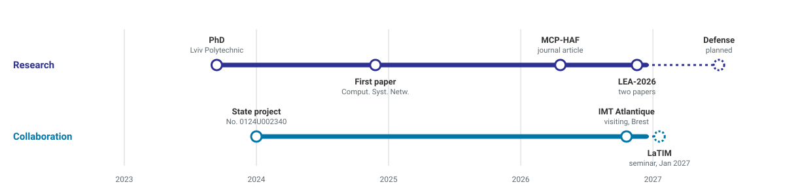

<picture>
  <source media="(prefers-color-scheme: dark)" srcset="assets/hero-dark.svg">
  
</picture>

I study how a patient can be re-identified once a hospital lets AI work on their records, and I build the parts of a
clinical AI system that measure this risk and refuse what would give the patient away. I am a PhD candidate in
Computer Engineering and a Senior Lecturer at Lviv Polytechnic National University, Ukraine. In 2026 I was a visiting
researcher at IMT Atlantique, Lab-STICC (Brest, France), on a French Government NADIYA scholarship.

[ORCID](https://orcid.org/0009-0008-8722-5769) · [LinkedIn](https://www.linkedin.com/in/pavlo-zamroz) · [Lviv Polytechnic](https://lpnu.ua/en)

### The problem

Removing names does not make a medical record anonymous: a few diagnoses can point to one person. And one patient's
data now leave the clinic through several channels at once: a released dataset, a question to an external language
model, a model trained on the records. Each channel can pass its own check while together they still give the
patient away.

### What I work on

| Question | My approach |
|---|---|
| How risky is this one record? | Measure each record's linkage risk with a surrogate attack and set its de-identification depth from it [3] |
| Does km-anonymity hold for the table actually released? | Verify the guarantee on the released table and measure what enforcing it costs on complete diagnosis histories [7] |
| What happens when channels combine? | Track risk per patient across channels; one language-model session can break km-anonymity of released histories [4, 6] |
| Who should see what? | Build a separate de-identified view for each party and refuse when the view would point to a person [5] |
| What reaches an external model? | Middleware between the clinic and external language models that protects both text and embeddings [1] |

I work with MIMIC-IV and eICU-CRD under PhysioNet credentialed access. Public repositories hold code and aggregate
results only, never patient records.

### Research path

<picture>
  <source media="(prefers-color-scheme: dark)" srcset="assets/path-dark.svg">
  
</picture>

### Publications

1. **P. Zamroz**, “MCP-HAF: Protocol-driven hybrid anonymization framework for context protection in medical RAG systems,” *Computer Systems and Networks*, 8(1), 106–114, 2026. [doi:10.23939/csn2026.01.106](https://doi.org/10.23939/csn2026.01.106)
2. **P. Zamroz**, Y. Morozov, “Large language models and personal information: Security challenges and solutions through anonymization,” *Computer Systems and Networks*, 6(2), 72–81, 2024. [doi:10.23939/csn2024.02.072](https://doi.org/10.23939/csn2024.02.072)
3. **P. Zamroz**, “[Choosing the de-identification depth of each patient record by its measured linkage risk](https://peers.international/paper/choosing-de-identification-depth-each-patient-record-its-measured-linkage-risk),” *LEA-2026*, Lviv, 2026.
4. **P. Zamroz**, “[One language-model session breaks km-anonymity of released patient diagnosis histories](https://peers.international/paper/one-language-model-session-breaks-k-anonymity-released-patient-diagnosis-histories),” *LEA-2026*, Lviv, 2026.
5. **P. Zamroz**, K. Oleksyak, “A method of adaptive anonymization of medical records based on derived representations by party authority,” *Electronics and Information Technologies*, in revision.
6. **P. Zamroz**, S. Vaton, K. Kallas, “One patient, many channels: Accounting for re-identification risk in clinical retrieval-augmented generation,” in preparation. [Code](https://github.com/clinical-ai-privacy/one-patient-many-channels)
7. **P. Zamroz**, K. Kallas, S. Vaton, “Suppress codes, not patients: What km-anonymity costs on complete diagnosis histories,” in preparation.

### Talks and visits

- **Jan 2027** · Invited seminar, LaTIM (INSERM UMR 1101), Brest
- **Nov 2026** · Two posters, LEA-2026, Lviv
- **Oct–Nov 2026** · Visiting researcher, IMT Atlantique, Lab-STICC, Brest

### Teaching

Information Security in Computer Systems and Computer Networks at the Department of Electronic Computing Machines.
I founded a student 3D-printing and technology lab.

The images are drawn by <a href="scripts/draw.py">scripts/draw.py</a>, with no third-party image services.
